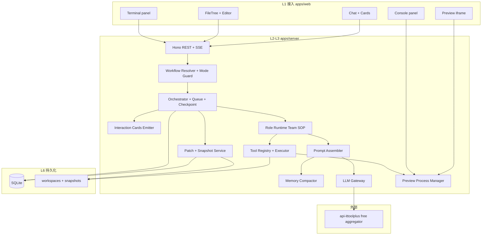
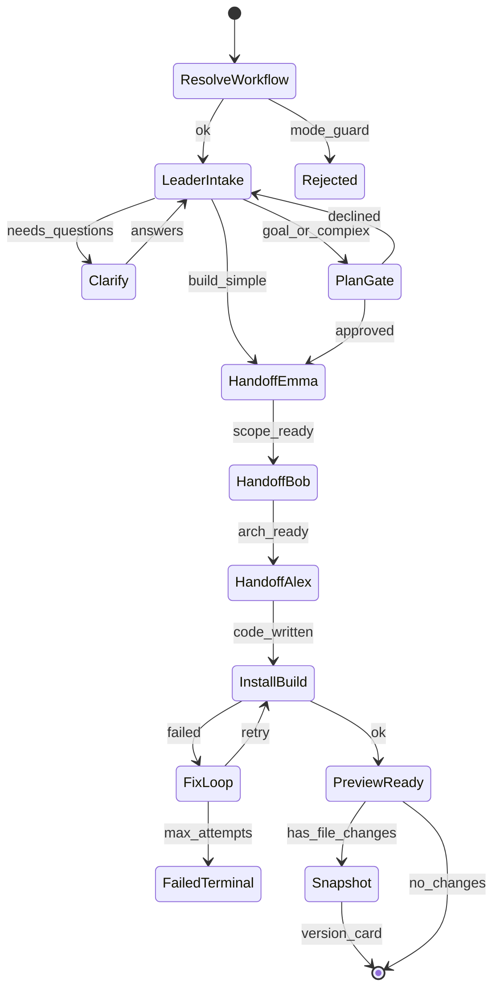
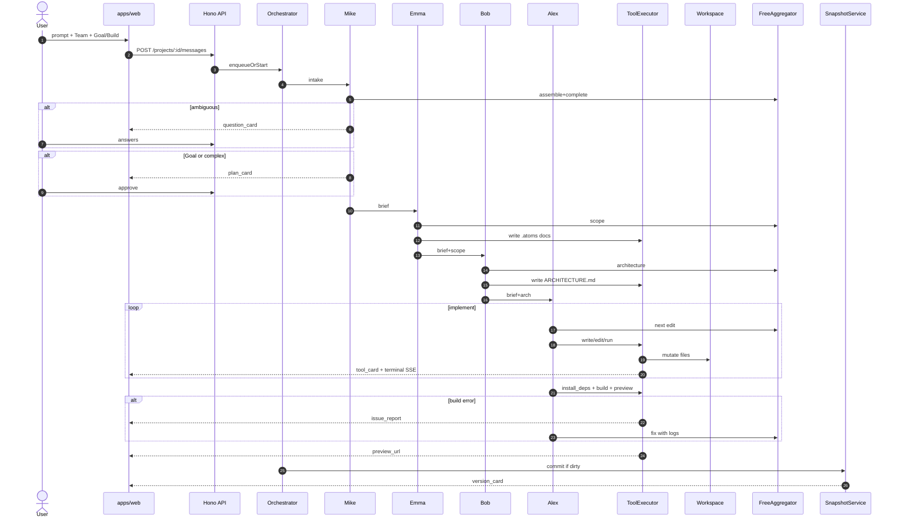
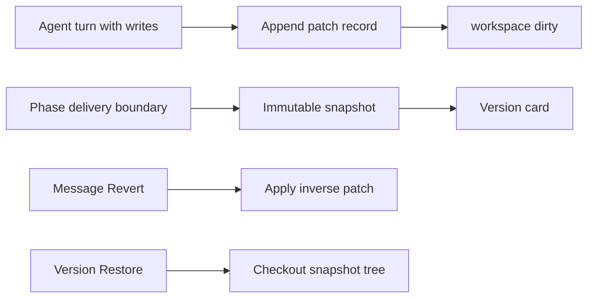
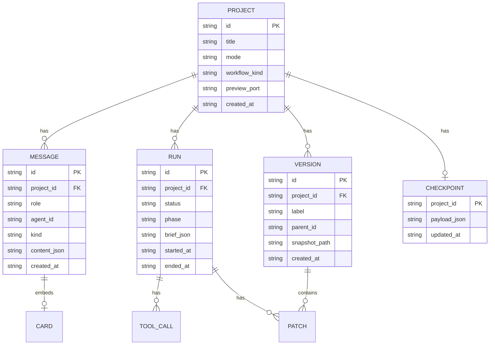

# z-app-agent 架构设计

> 阶段：第 1.1（架构设计）。配套需求：[requirements.md](./requirements.md)  
> 参考：`.ref/atoms/docs/atoms-dev-architecture.md`（采纳其不变量与 SOP，不复刻闭源实现）

## 1. 系统概览

z-app-agent 是本地优先的「应用生成智能体」：控制台（React）经 SSE/REST 驱动编排服务（Hono），编排服务运行 **完整 Team Mode** 多角色 SOP，通过工具读写项目工作区，调用免费 LLM 聚合完成推理，最终在 iframe 中预览生成的 Vite 应用。

**核心赌注**（继承 atoms 调研结论）：把不可靠的 LLM 生成包在可靠的状态机、快照与可回滚之外；用工程确定性兜住模型不确定性。

### 1.1 技术栈

| 层 | 选择 | 理由 |
|----|------|------|
| 控制台 | pnpm + Vite + React + TS + Tailwind + shadcn/ui | 任务强制；与生成物同生态 |
| API / 编排 | Node.js + TypeScript + Hono | 与前端同语言；SSE 友好；对接 OpenAI 兼容客户端简单 |
| 共享类型 | `packages/shared` | Brief / Card / Tool / Event schema 前后端共用 |
| 元数据存储 | SQLite（Node `node:sqlite` DatabaseSync） | 零运维；P0 单机足够；无原生编译依赖 |
| 工作区 | `workspaces/<projectId>/` | 本机目录隔离；gitignore |
| 快照 | 工作区旁 `snapshots/<projectId>/<versionId>/` 或 tar | 不可变追加 |
| LLM | 通用 OpenAI 兼容客户端（`.env`：`LLM_BASE_URL`/`LLM_API_KEY`/`LLM_MODEL`） | 默认同 ittoolplus；可换 OpenAI/DeepSeek 等 |
| 包管理 | pnpm workspace | monorepo |

### 1.2 分层架构图



| 层 | 名称 | 职责 |
|----|------|------|
| L1 | 接入 | SPA、鉴权占位、面板布局 |
| L2 | 会话与编排 | 工作流、队列、单活跃任务、卡片、计量占位、checkpoint |
| L3 | Agent 与工具 | 八角色、brief、prompt、工具、模型路由 |
| L4 | 工作区 | 文件树、patch、Terminal 流 |
| L5 | 构建与预览 | install/build/dev、预览代理、Console |
| L6 | 持久化 | SQLite 元数据 + 磁盘快照 |
| L7 | 发布 | **接口位预留**，P0 不实现 |

### 1.3 信任边界

| 边界 | 规则 |
|------|------|
| 前端 vs LLM Key | Key 只在 server `.env`（`LLM_API_KEY`）；前端永不持有 |
| 控制台用户 vs 产物用户 | P0 无产物 Auth；概念上不得混为一谈 |
| Terminal vs Console | Agent 执行日志与产物运行时日志分通道，禁止混流 |
| 文字产出 vs 状态变更 | 仅 Snapshot Service 在写盘成功后签发 Version |
| Server 状态 vs IndexedDB | IndexedDB 只缓存消息/草稿/日志投影；Restore/Revert/Version 后作废重拉；裁定权在 server |

## 2. 仓库与模块

### 2.1 文件树规划

```text
z-app-agent/
├── .atoms/                    # 本仓库项目记忆（非生成物）
├── .ref/atoms/                # atoms 调研只读参考
├── .tmp/                      # 阶段任务说明
├── docs/
│   ├── requirements.md
│   └── architecture.md
├── apps/
│   ├── web/                   # 控制台
│   │   ├── src/
│   │   │   ├── components/    # chat、cards、file-tree、preview…
│   │   │   ├── hooks/         # useProjectSSE、useChat
│   │   │   ├── lib/           # api client
│   │   │   └── pages/
│   │   └── package.json
│   └── server/                # 编排服务
│       ├── src/
│       │   ├── index.ts
│       │   ├── routes/        # projects、messages、versions、preview
│       │   ├── orch/          # orchestrator、queue、checkpoint、workflow
│       │   ├── roles/         # mike、emma、bob、alex、… + runtime
│       │   ├── prompt/        # assembler、budget
│       │   ├── memory/        # compact、atoms-docs
│       │   ├── tools/         # registry、executors、sandbox-path
│       │   ├── llm/           # openai-compatible client
│       │   ├── snap/          # patch、snapshot
│       │   ├── preview/       # process manager、proxy
│       │   └── db/            # schema、repos
│       └── package.json
├── packages/
│   └── shared/                # zod/types：Brief、Card、Events、Tools
├── workspaces/                # runtime 生成，gitignore
├── data/                      # sqlite + snapshots，gitignore
├── pnpm-workspace.yaml
├── package.json
└── .wiki.md
```

### 2.2 模块职责

| 模块 | 职责 | 关键文件（计划） |
|------|------|------------------|
| Workflow Resolver | Build/Goal × Team/Engineer → workflow 记录 | `orch/workflow.ts` |
| Mode Guard | 拒绝非法模式组合 | `orch/mode-guard.ts` |
| Orchestrator | 驱动 SOP 阶段机；单活跃任务 | `orch/orchestrator.ts` |
| Message Queue | 入队/重排/暂停/清空 | `orch/queue.ts` |
| Checkpoint Store | 持久化阶段游标 | `orch/checkpoint.ts` |
| Role Runtime | 加载角色 prompt、工具白名单、执行一轮 | `roles/runtime.ts` |
| Prompt Assembler | S0–S6 分层组装 + 预算 | `prompt/assembler.ts` |
| Memory Compactor | 截断/摘要 | `memory/compactor.ts` |
| LLM Gateway | 流式 chat.completions；错误上抛 | `llm/client.ts` |
| Tool Executor | 路径沙箱 + 超时 + 审计日志 | `tools/*` |
| Patch/Snapshot | 回合 diff；版本 tar；Revert/Restore | `snap/*` |
| Preview Manager | 端口池；子进程；反向代理 | `preview/*` |

## 3. 关键决策

| Decision | Choice | Rationale |
|----------|--------|-----------|
| 后端语言 | Node/TS + Hono | 与前端、OpenAI SDK 生态一致 |
| 首期协作 | 完整 Team Mode，串行 SOP | 任务强调中间过程；串行降低并发写冲突 |
| project ≈ chat | 1:1 | 消除上下文/版本/文件树归属歧义 |
| 状态变更信号 | 仅 Snapshot 签发 Version | 防幻觉「自称完成」 |
| 快照 | 不可变只追加 | Restore/Remix 语义前提 |
| 写路径 | 高权限只经工具层 | 可审计、可回滚 |
| 沙箱 P0 | 本机目录 + path jail | 实现快；Docker 放 P1 |
| 元数据 | Node `node:sqlite` | 单机零运维；无 better-sqlite3 原生编译 |
| 浏览器缓存 | IndexedDB（投影/草稿/日志） | 非真相源；冲突以 server 为准 |
| 模型 | 免费聚合，失败显式 | 符合任务要求；禁止伪造成功 |
| 生成物默认栈 | Vite + React + TS + Tailwind + shadcn | 与控制台一致，降低模板复杂度 |
| 专家并行 | P0 不做 | 避免同文件并发写；P1 再评估 |

## 4. Team Mode SOP

### 4.1 主路径状态机



条件分支：

- Mike 可在 Intake 后插入 `HandoffIris` / `HandoffDavid`，完成后再回主路径。
- `@Alex` 等用户点名：可跳过部分规划（仍更新 brief 摘要），但不得绕过路径沙箱与版本规则。
- Engineer Mode：折叠为 `LeaderIntake` 可选 → 直接 `HandoffAlex`。

### 4.2 端到端时序（首发）



### 4.3 Brief 与角色交接

```ts
// packages/shared — 权威契约
export type RoleId =
  | 'mike' | 'emma' | 'bob' | 'alex'
  | 'david' | 'iris' | 'sarah' | 'adrian'

export type Brief = {
  goal: string
  sections: string[]
  constraints: string[]
  quality_rules: string[]
  assignees: RoleId[]
  acceptance: string[]
  source_message_id: string
}
```

交接规则：

1. 下游角色输入 = `Brief` + 指定记忆文件 + 文件树摘要 +（可选）上游产出路径。
2. 用户追问由 Mike **合并**进 brief，不丢弃 `constraints`。
3. Sarah/Adrian 被派到时：返回结构化「能力未接通」结果，记入 activity，不写假 Version。

### 4.4 反思与修复闭环

```text
build/preview error
  → IssueReport { logs, stack, phase }
  → FixLoop: Alex + resolve_issue
  → attempt <= MAX_FIX_ATTEMPTS (default 3)
  → success → continue Snapshot
  → exhausted → FailedTerminal（UI 明确失败，保留现场）
```

「反思」在 P0 实现为：**基于工具结果的确定性门禁**（build exit code、preview 探活），而非单独 Critic Agent。P1 可加轻量 Reviewer 角色读 diff。

## 5. 会话、队列、中断恢复

### 5.1 会话模型

- 创建 Project 即创建唯一 Chat。
- 所有消息、版本、checkpoint 挂在 `project_id` 下。
- 不提供「同一项目多会话」；需要分叉时（P2）做 Remix=新 project。

### 5.2 队列

| 操作 | 语义 |
|------|------|
| enqueue | Agent 忙时用户消息入队 |
| reorder | 调整未执行消息顺序 |
| pause/resume | 暂停自动取队 |
| clear | 丢弃未执行队列 |
| stop | 取消当前 run；可选 clear；保留磁盘变更 |

### 5.3 Checkpoint

每次阶段迁移时写入：

```ts
type Checkpoint = {
  project_id: string
  run_id: string
  phase: string          // e.g. handoff_alex
  brief: Brief
  queue_cursor: number  // queue index within phase
  pending_queue: string[] // message ids
  workspace_hash: string
  updated_at: string
}
```

恢复策略：

1. Server 启动扫描未闭合 `run`。
2. 若 workspace_hash 匹配 → 可自动续跑或「等待用户 Confirm resume」。
3. 若不匹配 → 标记冲突，要求用户选择「以磁盘为准继续」或 Restore 版本后继续。
4. **不**静默丢弃失败 run。

## 6. Prompt 与上下文

### 6.1 分层（S0–S6）

| 层 | 内容 |
|----|------|
| S0 | 角色系统提示、输出 JSON/工具调用格式、红线 |
| S1 | 可用工具列表、模式、生成物栈约束 |
| S2 | 文件树摘要、最近 diff、当前版本 id |
| S3 | 工具 schema |
| S4 | 历史消息（压缩后） |
| S5 | 本轮用户输入、`#` 文件引用、brief |
| S6 | `.atoms/*.md` 按需截断读入 |

### 6.2 预算

- 按模型窗口配置 `ContextBudget`；免费小模型使用更紧预算。
- 裁剪顺序：旧原始轮次 → 文件树细节 → 记忆文档次要章节 → 摘要压缩。
- **永不裁剪**：S0 红线、`brief.constraints`、当前用户消息。

## 7. 工具与沙箱

### 7.1 路径沙箱

```ts
function resolveInWorkspace(projectId: string, rel: string): string {
  const root = path.resolve(WORKSPACES_ROOT, projectId)
  const abs = path.resolve(root, rel)
  if (!abs.startsWith(root + path.sep) && abs !== root) {
    throw new Error('path_escape')
  }
  return abs
}
```

`run_command`：`cwd` 必须在 workspace 内；黑名单危险命令（可选）；超时 kill。

### 7.2 工具审计

每次调用写 `tool_calls` 表：`id, project_id, run_id, role, name, args_json, result_status, duration_ms`。  
UI tool_card 由此表/事件流投影。

### 7.3 预览进程

- 端口池例如 `3900 + slot`。
- `pnpm install` → `pnpm dev --port <p> --host 127.0.0.1`。
- Server 将 `/preview/:projectId/*` 代理到对应端口。
- 项目删除/暂停时杀掉子进程。

## 8. 版本管理



| 粒度 | 操作 | 存储 |
|------|------|------|
| 消息级 | Revert | patch（unified diff 或文件前后哈希） |
| 版本级 | Restore | 完整目录快照 / tar |
| 项目级 | Remix（P2） | 复制快照到新 project_id |

规则：快照**禁止原地修改**；Restore 是「当前指针移动 + 工作区替换」，历史行仍在。

## 9. 数据模型

### 9.1 ER（逻辑）



### 9.2 事件流（SSE）

```ts
type ServerEvent =
  | { type: 'message.delta'; message_id: string; text: string }
  | { type: 'card'; card: QuestionCard | PlanCard | VersionCard | ToolCard | ActivityCard }
  | { type: 'terminal'; chunk: string }
  | { type: 'console'; chunk: string }
  | { type: 'run.status'; run_id: string; status: string; phase: string }
  | { type: 'preview.ready'; url: string }
  | { type: 'error'; code: string; message: string }
```

客户端只追加渲染；项目状态以服务端 DB + 磁盘为准。

## 10. API 草图

| Method | Path | 说明 |
|--------|------|------|
| POST | `/api/projects` | 创建项目+工作区（可打脚手架模板） |
| GET | `/api/projects/:id` | 元数据 |
| GET | `/api/projects/:id/events` | SSE |
| POST | `/api/projects/:id/messages` | 用户消息 / `@` / 附件元数据 |
| POST | `/api/projects/:id/plan/:cardId/approve` | 批准计划 |
| POST | `/api/projects/:id/plan/:cardId/decline` | 拒绝并附理由 |
| POST | `/api/projects/:id/stop` | 停止 |
| GET | `/api/projects/:id/files` | 文件树 |
| GET | `/api/projects/:id/files/*` | 读文件 |
| GET | `/api/projects/:id/versions` | 版本列表 |
| POST | `/api/projects/:id/versions/:vid/restore` | Restore |
| POST | `/api/projects/:id/messages/:mid/revert` | Revert |
| POST | `/api/projects/:id/issues/:id/resolve` | 修复 |
| GET | `/preview/:id/*` | 预览代理 |
| GET | `/healthz` | 探活 |
| GET | `/api/llm/status` | 代理聚合 free-status（无 Key） |

## 11. LLM Gateway

通用 **OpenAI Chat Completions** 客户端（`apps/server/src/llm/client.ts`）：

```ts
POST {LLM_BASE_URL}/chat/completions
Authorization: Bearer {LLM_API_KEY}   // 若配置
```

默认 `LLM_BASE_URL=https://ittoolplus.cn/api/openai/v1`。任意兼容上游（OpenAI / DeepSeek / SiliconFlow / OpenRouter / 本地 vLLM 等）通过 `.env` 切换，无需改代码。

环境变量：

| 变量 | 说明 |
|------|------|
| `LLM_BASE_URL` | 含 `/v1` 的兼容基址 |
| `LLM_API_KEY` / `OPENAI_API_KEY` | 可选 Bearer |
| `LLM_MODEL` | 模型 id；ittoolplus 可用 `auto` |
| `LLM_TIMEOUT_MS` | 请求超时 |
| `LLM_EXTRA_HEADERS` | JSON 额外头 |

编排策略：同一 turn 内最多重试 2 次网络类错误；模型 4xx 不重试；耗尽则 `run.status=failed` + error 事件。

## 12. 前端信息架构

首屏三栏（可参考 atoms 控制台，不复刻视觉）：

1. **左**：对话 + 卡片 + 输入（模式开关、`@`）。
2. **中**：Preview / 可选 Diff。
3. **右或底**：Files | Terminal | Console。

卡片组件与 `packages/shared` 的 card discriminant 一一对应，避免前后端字段漂移。

## 13. 失败模式

| 阶段 | 失败 | 用户可见 | 系统行为 |
|------|------|----------|----------|
| LLM | 503/超时 | error 事件 | 有限重试 → fail run |
| 路径逃逸 | path_escape | tool 失败卡 | 拒绝写 |
| install | 依赖错误 | Terminal + Issue | 可 Resolve |
| build | 编译错误 | 同上 | FixLoop |
| preview | 端口占用/崩溃 | Preview 错误态 | 释放槽位、报错 |
| checkpoint 冲突 | hash mismatch | 恢复对话框 | 等待用户选择 |
| stub 角色 | 未接通 | activity 说明 | 不发 Version |

## 14. 实现指引（映射后续任务）

建议 task02+ 切片顺序：

1. **骨架**：pnpm workspace、Hono hello、React 壳、SSE 打通。
2. **项目+工作区**：创建目录、脚手架模板、文件树 API。
3. **单角色 Alex + 工具**：能 NL→改文件→preview（验证闭环）。
4. **Snapshot/Patch**：Version card、Revert。
5. **Team SOP**：Mike/Emma/Bob 串入；Plan/question 卡片。
6. **Queue/Stop/Checkpoint**：中断恢复。
7. **FixLoop + Issue**：修复闭环。
8. **记忆文档**：生成物 `.atoms` 读写纪律。
9. **打磨**：Engineer Mode、Iris/David、导出 ZIP。

P0 演示以步骤 1–8 为准。

## 15. 与 atoms 调研的差异清单

| 主题 | 本系统 |
|------|--------|
| 8 角色名与职责 | 对齐，便于心智模型 |
| MetaGPT 血统 | 方法论借鉴，运行时自研 TS |
| Cloud / 双钱包 / 发布 | 延后 |
| 记忆压缩算法 | 简化截断+摘要 |
| 主站 Nuxt | 改为 React 控制台 |
| 容器沙箱 | P1 |

## 16. 开放工程风险

1. 免费模型上下文短、工具调用不稳定 → 用**强脚手架 + 小步 edit_file**降低单次生成体量。  
2. 本机命令执行安全 → path jail + 超时 + 后续 Docker。  
3. 长会话质量 → 尽早写 `.atoms` 记忆，而非加大窗口。  
4. 多角色成本（多次 LLM 调用）→ brief 尽量短；允许 Build 模式跳过冗长 Plan。
